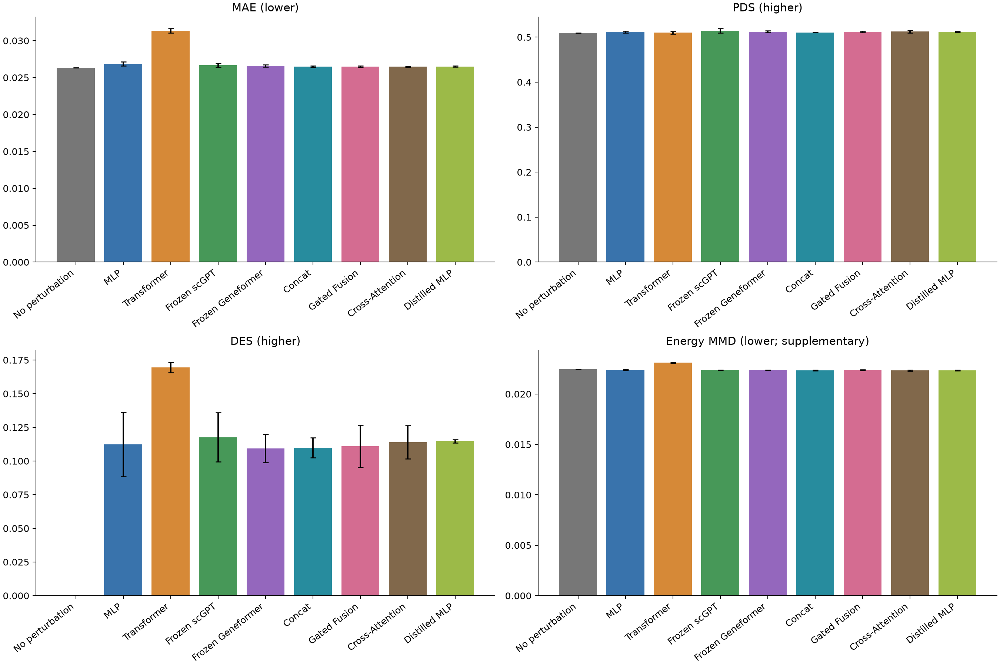

# FusionVC

**A personal learning project on representation fusion, MMD and distillation for single-cell perturbation prediction.**

[中文](README.md) · [Detailed overview](docs/experiment-overview.md) · [Final results](results/final-test/README.md) · [Reproduction guide](docs/reproduce.md)

Author: [xifengke](https://github.com/xifengke). The goal is to practice data processing, model adaptation, controlled experiments, evaluation and inference delivery using established methods.
The results do not establish a new foundation model, a universally superior predictor or an experimentally confirmed biological mechanism.

## What is included

The task uses VCC2025 H1 hESC single-gene CRISPRi data, with 150 training, 50 validation and 100 disjoint test targets and all18,080 output genes.
Cell counts include controls; adding split-file cell counts does not give a count of fully independent biological samples.

| Part | Implementation |
| --- | --- |
| Baselines | MLP and a Transformer trained from random initialization |
| Frozen representations | scGPT whole-human and Geneformer V1-10M |
| Fusion | Concat, target-conditioned Gated Fusion, bidirectional gene-prototype Cross-Attention |
| Loss comparisons | Unpaired mean MSE, Energy MMD, mean MSE + 0.1 × Energy MMD |
| Distillation | Fixed fusion teacher; original MLP student; mean MSE + 1.0 × mean-response KD |

There are 63 architecture/loss/seed validation runs and three formal students, using seeds 42/43/44.
The teacher is selected by three-seed validation MAE over nine fusion/loss groups, then fixed to seed42 of the winning group: Concat + Energy MMD.
Only the150 training targets receive soft labels. Final selection is frozen before test-expression access.
Local offline scoring covers 27 checkpoints and one reference using pinned official evaluation tools, without claiming an official leaderboard submission.

## Held-out test results

The complete test contains 170,846 cells, 18,080 genes and 100 perturbation targets, including 38,176 controls.
Values are three-seed model means; standard deviations, selected losses and conditional target-level intervals are in the [full report](results/final-test/README.md).
Different architectures select losses under the same candidate budget, so this is not a pure architecture ablation.

| Configuration | MAE ↓ | PDS ↑ | DES ↑ |
| --- | ---: | ---: | ---: |
| No perturbation | **0.026342** | 0.509600 | 0.000189 |
| MLP | 0.026853 | 0.511533 | 0.112435 |
| Transformer | 0.031355 | 0.510033 | **0.169593** |
| Frozen scGPT | 0.026664 | **0.514233** | 0.117656 |
| Frozen Geneformer | 0.026587 | 0.512000 | 0.109469 |
| Concat | 0.026487 | 0.510200 | 0.109815 |
| Gated Fusion | 0.026492 | 0.511700 | 0.110926 |
| Cross-Attention | **0.026463** | 0.512367 | 0.113918 |
| Distilled MLP | 0.026509 | 0.511933 | 0.114757 |

All eight neural configurations have higher mean MAE and higher DES than the no-perturbation reference. No configuration dominates all metrics.
The matched distillation control is **MLP mean**, not the MLP energy configuration in the table.
Student test MAE decreases from 0.026957 to 0.026509, about **1.66%**, with improvement on 87/100 seed-averaged targets.
PDS is essentially unchanged, while DES decreases from 0.121207 to 0.114757. Student MAE remains above the actual teacher and reference, so transfer is not lossless.

## Resources and actual data use

Full experiments ran on Windows, Python 3.12, PyTorch 2.8.0+cu128 and an RTX 4060 Laptop GPU with **8 GB VRAM**.
Frozen encoders, offline features, limited candidate inputs, mixed precision, block reads, disk-backed arrays and sequential scoring control costs.
These are implementation and scope choices; undocumented RAM exhaustion or OOM is not asserted.

**The entire test set was downloaded and used.** The pinned h5ad is approximately 11.95 GB.
The real float32 test cache and one temporary prediction matrix are approximately 12.36 GB each; predictions are removed after scoring.
Leaving large files out of the source repository does not mean the experiments omitted them.
RAM, VRAM, disk and network constraints differ, and minimum RAM or cross-hardware requirements were not established.
See [resource notes](docs/resources-and-data.md).

## Limitations and reproduction

The scope is one data background and one cell type. Cross-cell-type, independent-dataset, dose, combination and time-course generalization were not tested.
Models apply a shared condition-dependent shift to sampled controls; heterogeneity mainly comes from those controls.
Frozen prototype attention is not an online cell-state-dependent response model. Full-parameter foundation-model fine-tuning and exhaustive ablations were not performed.

Three seeds are not biological replicates. Target-bootstrap intervals are conditional on fitted models and fixed controls and are not adjusted for multiple comparisons.
`VERIFIED` refers to the stated internal artifact/provenance/reproduction checks, not peer review, independent external reproduction or scientific certification.

Source checks, inference, experiment reconstruction and original-workspace auditing have different prerequisites: see the [guide](docs/reproduce.md).
The source release excludes raw data, pretrained weights, full checkpoints, caches and the local student bundle.
That approximately 26.3 MB bundle includes 256 training controls and must be obtained separately or exported after training; a fresh clone does not automatically provide a trained model.

The recorded full local environment passed 69 tests and Ruff. CPU-only checks can skip GPU-specific cases.
Exact same-environment reruns do not guarantee cross-hardware bitwise identity. Remote Actions success requires an actual run.

## Attribution and documentation

[Documentation](docs/README.md) · [Scope](docs/project-scope.md) · [MMD results](results/fusion-mmd/README.md) · [Distillation and costs](results/distillation/README.md) · [Third-party sources](THIRD_PARTY.md) · [Citation](CITATION.md) · [Publication notes](docs/publication.md)

Project-owned code is licensed under the [MIT License](LICENSE), copyright (c) 2026 xifengke.
Third-party data, weights and software retain their own terms. AI tools assisted code, documentation and experiment execution; the author remains responsible for reviewing the release and its claims.
