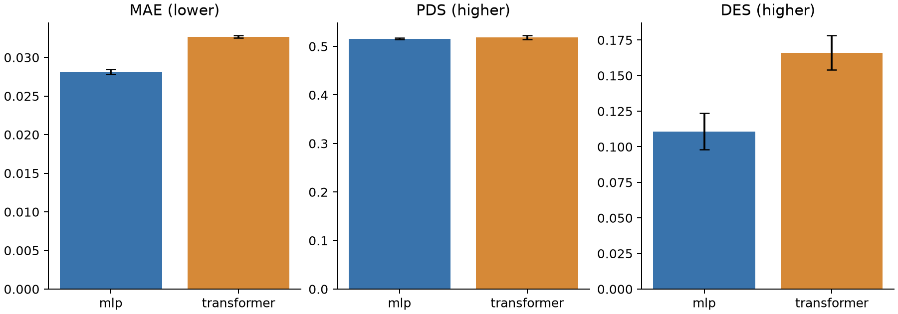

# MLP / Transformer validation results

VCC 2025 official validation split; 18,080 genes. Test untouched.

Pseudobulk-trained condition mean-shift models; full required cell counts in evaluation.

| Model | Seeds | MAE ↓ | PDS ↑ | DES ↑ |
| --- | ---: | ---: | ---: | ---: |
| no_perturbation | fixed sample | 0.027547 | 0.514400 | 0.000187 |
| 01_mlp | 3 | 0.028150 ± 0.000330 | 0.515467 ± 0.001514 | 0.110852 ± 0.012764 |
| 02_transformer | 3 | 0.032676 ± 0.000178 | 0.518667 ± 0.004007 | 0.166169 ± 0.012129 |

Raw validation metrics; not the historical competition normalized score.
Standard deviation is across training seeds; control sampling is held fixed.
See `runs.csv` for runtime, parameters, selected epochs and GPU memory.
Each run includes training logs/configs and per-perturbation metrics.

## Auxiliary references

Same full-cell sampling plan. No-perturbation DES uses full cells; average-training-shift DES remains unevaluated.

| Reference | MAE ↓ | PDS ↑ | DES ↑ |
| --- | ---: | ---: | ---: |
| no_perturbation | 0.027547 | 0.514400 | 0.000187 |
| average_training_shift | 0.028181 | 0.518800 | not evaluated |

Both neural baselines have higher MAE than the no-perturbation reference.
Transformer improves DES relative to MLP, while its MAE is worse.
PDS remains close to the uninformative-reference scale; no convincing target identification gain.
Transformer best epochs are all 1: optimization improves training loss but harms validation.
These are useful first baselines and negative findings, not a completed competitive model.
The first protocol models mean shifts; future distribution-modeling changes require rerunning baselines.
Full four-model comparison: [no-perturbation reference report](../controls/README.md).
