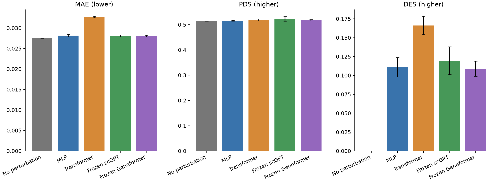

# 无扰动对照与四种模型的完整验证比较

已补算无扰动对照 DES：与四种模型使用相同的 98,927 个完整验证细胞、18,080 个基因、50 个扰动、控制抽样和官方 VCC profile。测试集未使用。
无扰动预测对每个条件都使用训练对照细胞、delta=0，保留细胞异质性及原归一化规则；不人为指定 DES=0。

## 主比较：四种模型均使用均值损失

| 方法 | MAE ↓ | PDS ↑ | DES ↑ |
| --- | ---: | ---: | ---: |
| 无扰动对照 | 0.027547 | 0.514400 | 0.000187 |
| MLP | 0.028150 ± 0.000330 | 0.515467 ± 0.001514 | 0.110852 ± 0.012764 |
| Transformer | 0.032676 ± 0.000178 | 0.518667 ± 0.004007 | 0.166169 ± 0.012129 |
| Frozen scGPT | 0.028064 ± 0.000248 | 0.522267 ± 0.010661 | 0.119606 ± 0.018453 |
| Frozen Geneformer | 0.028047 ± 0.000185 | 0.517200 ± 0.002433 | 0.108999 ± 0.010014 |

神经模型为三个训练种子的均值 ± 标准差；无扰动对照为同一固定控制抽样的一次完整评价，不人为复制成三个种子。
所有模型仍按原验证 MAE 选择 checkpoint，本次补算未重新训练或按 DES 挑选模型。

## 与无扰动对照的差值

| 方法 | MAE 差值（负数更好） | PDS 差值（正数更好） | DES 差值（正数更好） |
| --- | ---: | ---: | ---: |
| MLP | +0.000603 | +0.001067 | +0.110665 |
| Transformer | +0.005129 | +0.004267 | +0.165982 |
| Frozen scGPT | +0.000518 | +0.007867 | +0.119419 |
| Frozen Geneformer | +0.000501 | +0.002800 | +0.108812 |

MAE：四个主组均高于无扰动对照；全部三种损失的组均值也高于该对照。
MLP 主组 PDS 差值的 50 靶点配对 95% 区间 [-0.002933, 0.005200]。
Transformer 主组 PDS 差值的 50 靶点配对 95% 区间 [-0.005333, 0.014133]。
Frozen scGPT 主组 PDS 差值的 50 靶点配对 95% 区间 [-0.001200, 0.019600]。
Frozen Geneformer 主组 PDS 差值的 50 靶点配对 95% 区间 [-0.001333, 0.007467]。
DES：MLP、Transformer、Frozen scGPT、Frozen Geneformer 主组高于无扰动对照。
这表示模型找回了一部分真实显著变化基因，不能据此认定整体预测能力已经优于简单对照。
三项指标应分别报告，不能把 MAE 不如对照扩大成三项都不如对照。配对区间仅对当前拟合模型、固定控制抽样和验证靶点成立。



## 三种训练损失的全部比较

| 方法 | 损失 | MAE ↓ | PDS ↑ | DES ↑ |
| --- | --- | ---: | ---: | ---: |
| 无扰动对照 | — | 0.027547 | 0.514400 | 0.000187 |
| MLP | Mean | 0.028150 ± 0.000330 | 0.515467 ± 0.001514 | 0.110852 ± 0.012764 |
| MLP | MMD | 0.028053 ± 0.000272 | 0.515600 ± 0.001058 | 0.109802 ± 0.017928 |
| MLP | Mean + MMD | 0.028229 ± 0.000433 | 0.516133 ± 0.000833 | 0.110811 ± 0.017304 |
| Transformer | Mean | 0.032676 ± 0.000178 | 0.518667 ± 0.004007 | 0.166169 ± 0.012129 |
| Transformer | MMD | 0.033085 ± 0.000113 | 0.517200 ± 0.004543 | 0.163695 ± 0.010009 |
| Transformer | Mean + MMD | 0.032637 ± 0.000170 | 0.518133 ± 0.004406 | 0.165171 ± 0.012157 |
| Frozen scGPT | Mean | 0.028064 ± 0.000248 | 0.522267 ± 0.010661 | 0.119606 ± 0.018453 |
| Frozen scGPT | MMD | 0.027938 ± 0.000378 | 0.520667 ± 0.009833 | 0.115443 ± 0.020039 |
| Frozen scGPT | Mean + MMD | 0.028013 ± 0.000235 | 0.522800 ± 0.011200 | 0.118345 ± 0.018285 |
| Frozen Geneformer | Mean | 0.028047 ± 0.000185 | 0.517200 ± 0.002433 | 0.108999 ± 0.010014 |
| Frozen Geneformer | MMD | 0.027828 ± 0.000232 | 0.516533 ± 0.003107 | 0.103298 ± 0.010003 |
| Frozen Geneformer | Mean + MMD | 0.028013 ± 0.000192 | 0.516667 ± 0.002948 | 0.105782 ± 0.009513 |

## 一致性与复现

无扰动预测中被 FDR < 0.05 检出的显著基因总数（基因×靶点）为 405；具体情况见逐靶点诊断。
旧 MAE/PDS 的逐靶点最大绝对差异分别为 9.71e-17 / 8.33e-17。控制抽样与原 MLP 完全一致。
42 个旧 checkpoint 经核验未变；正式模型成绩未改动，测试集未使用。
DES 使用同一全细胞 Mann–Whitney/Wilcoxon 实现、tie/continuity correction、全基因×全靶点 BH 校正，显著性阈值 0.05，按绝对 log2 fold change 排序。

```powershell
./.venv/Scripts/python.exe scripts/evaluate_no_perturbation.py
```

[主比较数据](main_comparison.csv)、[全部损失比较](comparison.csv)、[逐靶点结果](per_perturbation.csv)、
[配对差值与区间](paired-comparisons.json)、[完整产物核验](artifact-verification.json)、
[无扰动官方成绩](no_perturbation/metrics.json)、[逐靶点 DE 数量](no_perturbation/de_gene_counts.csv)、
[无扰动一致性检查](no_perturbation/verification.json)。
