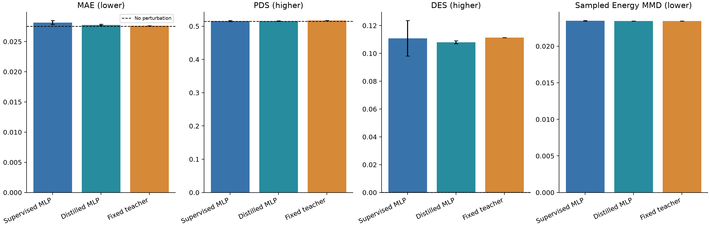

# 固定融合 Teacher → 原架构 MLP Student 的均值响应蒸馏

## Material Passport

| Field | Value |
| --- | --- |
| Origin Skill | academic-research-suite/experiment-agent |
| Stage | run |
| Date | 2026-10-15 |
| Version | distillation-v1 |
| Verification Status | VERIFIED |

Teacher 为 **05_concat_energy/seed_42**：在九个融合架构×损失组中，按三种子官方验证 MAE 均值最小选择，精确并列按 experiment 字典序。
胜出组三种子 MAE 均值为 0.027687；实际单 Teacher MAE 为 0.027640。所有 Student 共用该固定 checkpoint，不筛选最佳种子或使用 ensemble。
只对 150 个训练靶点离线生成 Teacher delta；训练时在相同 32 个控制细胞上经 apply_residual 转为表达均值，使用 mean MSE + 1.0 × KD MSE。未扩展 Student 的 MMD 任务损失。
Student 与原 MLP 架构、输入、初始化种子、预算及验证 MAE 选择规则一致；推理只用训练对照拟合的基因描述与 MLP，不调用 Teacher 或基础编码器。

| 方法 | 运行数 | MAE ↓ | PDS ↑ | DES ↑ | 附加 Energy MMD ↓ |
| --- | ---: | ---: | ---: | ---: | ---: |
| 无扰动对照 | 固定一次 | 0.027547 | 0.514400 | 0.000187 | — |
| Supervised MLP | 3 | 0.028150 ± 0.000330 | 0.515467 ± 0.001514 | 0.110852 ± 0.012764 | 0.023479 ± 0.000023 |
| Distilled MLP | 3 | 0.027756 ± 0.000114 | 0.515733 ± 0.001007 | 0.108059 ± 0.001013 | 0.023433 ± 0.000009 |
| Fixed teacher | 1 | 0.027640 | 0.516800 | 0.111431 | 0.023443 |

MLP 两组为种子 42/43/44 的均值 ± 样本标准差；Teacher 是实际使用的固定单模型，不能把胜出组均值当作它的成绩。

## 蒸馏学生的配对差值

| 参考 | 指标 | Student−参考 | 95% 靶点区间 |
| --- | --- | ---: | ---: |
| supervised_mlp | mae | -0.000394 | [-0.000482, -0.000307] |
| supervised_mlp | discrimination_score_l1 | +0.000267 | [-0.002267, +0.002667] |
| supervised_mlp | overlap_at_N | -0.002793 | [-0.010958, +0.005107] |
| supervised_mlp | energy_mmd_rms | -0.000046 | [-0.000070, -0.000025] |
| teacher | mae | +0.000116 | [-0.000048, +0.000275] |
| teacher | discrimination_score_l1 | -0.001067 | [-0.004667, +0.002400] |
| teacher | overlap_at_N | -0.003372 | [-0.011525, +0.004972] |
| teacher | energy_mmd_rms | -0.000010 | [-0.000083, +0.000047] |
| no_perturbation | mae | +0.000210 | [-0.000005, +0.000430] |
| no_perturbation | discrimination_score_l1 | +0.001333 | [-0.002133, +0.005333] |
| no_perturbation | overlap_at_N | +0.107872 | [+0.090517, +0.126011] |

蒸馏学生相对同架构纯监督 MLP 的 MAE 均值变化为 -1.40%。应同时检查 PDS/DES，单项变化不能扩大为整体能力提升。
区间先平均 Student/MLP 的三个种子，再对相同 50 个验证靶点做 5,000 次配对重采样；Teacher 保持固定。区间只对当前模型、Teacher/checkpoint 选择和控制抽样成立，未做多重比较校正。
同一验证集承担融合筛选、早停与本轮比较，存在选择乐观偏差；种子不是生物重复，均值蒸馏不证明分布或细胞状态机制迁移。测试集在本阶段未使用。

## 参数与实际成本

基准使用相同 150 个训练靶点、32 个训练对照、18,080 输出基因，float32，目标 batch=4；一轮预热后五轮测量。

| 方法 | 可训练参数 | 源冻结参数 | checkpoint MiB | 当前缓存加载秒 | 暖预测头毫秒/靶点 | 预测头+完整表达毫秒/靶点 | GPU 峰值 MiB |
| --- | ---: | ---: | ---: | ---: | ---: | ---: | ---: |
| supervised_mlp | 1,266,144 | 0 | 4.87 | 0.078 | 0.032 | 0.069 | 50.8 |
| distilled_mlp | 1,266,144 | 0 | 4.88 | 0.064 | 0.033 | 0.060 | 51.6 |
| teacher | 1,319,584 | 60,475,392 | 5.05 | 4.543 | 0.114 | 0.134 | 52.3 |

Teacher 原缓存记录的编码器特征提取为 11.34 秒；共同预处理原记录为 126.10 秒，均为历史实测的一次性共享成本，并非本次重新测量的冷启动。
两组依赖共同训练控制矩阵 2.571 GiB；静态目标表、缓存来源资产另列于成本 JSON。checkpoint 大小不是完整部署大小。
成本 JSON 分开列出数值预测 payload、研究来源校验实际读取的文件，以及仅 stat 的训练原始矩阵；原始矩阵的字节数不计为计算模型大小。当前研究 loader 的来源核验依赖与最小推理部署包是两种口径，后者另行导出和验证。

Teacher 与 Student 当前暖推理都使用缓存；编码器参数比不等于端到端加速。加载测量包含现有 loader 的文件/来源校验与 GPU 转移，未清除操作系统文件缓存；表达基准不含文件输出或官方 DE 评分。完整包含内容及五次原始测量见成本 JSON。

## 完整性与复现

训练前的 69 个 checkpoint 和 567 个历史结果文件均保持原 SHA256。
独立 trainer 的 KD=0 seed42 须逐 tensor、最佳轮次及核心训练日志复现原 MLP；正式 KD seed42 在独立目录重训。三次正式 Student 均作完整官方验证、相同控制抽样与 checkpoint 哈希核验。
Material Passport 仅在产物核验、KD0公平性、KD复现、测试与成本记录齐全且通过时为 VERIFIED，含义限于本轮可复现产物。

[Teacher选择](teacher-selection.json)、[训练软标签来源](teacher-cache.json)、[逐次成绩](runs.csv)、[均值标准差](summary.csv)、[逐靶点](per_perturbation.csv)、
[配对区间](paired-comparisons.json)、[KD0公平性](zero-kd-parity.json)、[精确复现](reproducibility-check.json)、[产物核验](artifact-verification.json)、
[成本基准](cost-benchmark.json)、[测试](validation-checks.json)、[协议](../../docs/distillation-protocol.md)。
