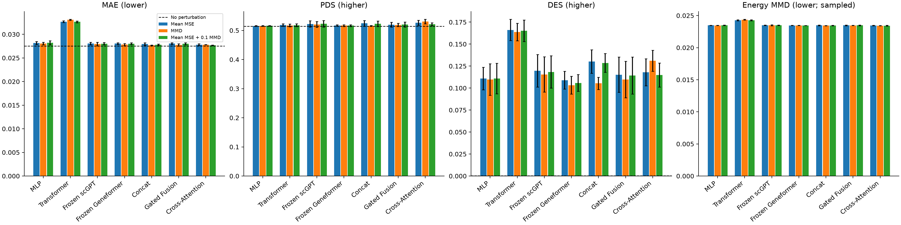

# 三种融合的 MMD 与混合损失完整验证比较

## Material Passport

| Field | Value |
| --- | --- |
| Origin Skill | academic-research-suite/experiment-agent |
| Stage | run |
| Date | 2026-10-15 |
| Version | fusion-v1 / fusion-mmd-v1 |
| Verification Status | VERIFIED |

本轮新增三种融合 × 纯 MMD/混合损失 × 三个种子，共 18/18 次完整官方验证；已有 9 次融合均值组保持原样。
三融合共有 27 次运行，与原四架构的 36 次三损失运行组成 63 次完整比较。测试集未使用。
Verification Status 只表示新增产物、六组 seed-42 重训、身份检查和测试记录通过；不表示生物机制或正式测试集泛化已验证。

## 三融合的三种损失

| 方法 | 损失 | MAE ↓ | PDS ↑ | DES ↑ | Energy MMD ↓ |
| --- | --- | ---: | ---: | ---: | ---: |
| 无扰动对照 | 固定一次完整评价 | 0.027547 | 0.514400 | 0.000187 | — |
| Concat | Mean MSE | 0.027949 ± 0.000246 | 0.524267 ± 0.009979 | 0.130118 ± 0.013330 | 0.023478 ± 0.000049 |
| Concat | MMD | 0.027687 ± 0.000060 | 0.516000 ± 0.001058 | 0.105373 ± 0.006877 | 0.023439 ± 0.000022 |
| Concat | Mean MSE + 0.1 MMD | 0.027817 ± 0.000131 | 0.522800 ± 0.009372 | 0.128540 ± 0.010671 | 0.023435 ± 0.000038 |
| Gated Fusion | Mean MSE | 0.028035 ± 0.000189 | 0.519867 ± 0.008122 | 0.115208 ± 0.020096 | 0.023476 ± 0.000053 |
| Gated Fusion | MMD | 0.027763 ± 0.000244 | 0.518800 ± 0.005600 | 0.109707 ± 0.020720 | 0.023468 ± 0.000036 |
| Gated Fusion | Mean MSE + 0.1 MMD | 0.027987 ± 0.000212 | 0.520267 ± 0.008488 | 0.114330 ± 0.021098 | 0.023474 ± 0.000056 |
| Cross-Attention | Mean MSE | 0.027817 ± 0.000182 | 0.526533 ± 0.008821 | 0.117929 ± 0.015328 | 0.023457 ± 0.000033 |
| Cross-Attention | MMD | 0.027811 ± 0.000021 | 0.530667 ± 0.007821 | 0.131071 ± 0.011871 | 0.023430 ± 0.000012 |
| Cross-Attention | Mean MSE + 0.1 MMD | 0.027689 ± 0.000074 | 0.521200 ± 0.005292 | 0.114884 ± 0.013650 | 0.023424 ± 0.000048 |

神经模型为三个种子 42/43/44 的均值 ± 样本标准差，无扰动对照不复制为多个种子。
Mean MSE 使用全训练细胞 pseudobulk 均值；纯 MMD 使用无配对预测/真实细胞集合，混合组为 Mean MSE + 0.1 MMD。
训练 MMD 集合大小为 32+32，附加评价 Energy MMD 固定抽取 64+64 个细胞，不是官方 VCC 指标或综合得分。

## 新损失相对自身均值组的配对差值

以下是新损失减自身 mean；MAE/附加 MMD 负数更好，PDS/DES 正数更好。方括号为条件性 95% 靶点 bootstrap 区间。

| 方法 | 损失 | MAE 差值 [95%] | PDS 差值 [95%] | DES 差值 [95%] | Energy MMD 差值 [95%] |
| --- | --- | ---: | ---: | ---: | ---: |
| Concat | MMD | -0.000262 [-0.000426, -0.000094] | -0.008267 [-0.020137, +0.000667] | -0.024745 [-0.038173, -0.012654] | -0.000039 [-0.000097, +0.000022] |
| Concat | Mean MSE + 0.1 MMD | -0.000133 [-0.000259, -0.000014] | -0.001467 [-0.008000, +0.004137] | -0.001578 [-0.006531, +0.003396] | -0.000043 [-0.000110, +0.000012] |
| Gated Fusion | MMD | -0.000272 [-0.000358, -0.000188] | -0.001067 [-0.005200, +0.002267] | -0.005502 [-0.007748, -0.003424] | -0.000008 [-0.000029, +0.000015] |
| Gated Fusion | Mean MSE + 0.1 MMD | -0.000048 [-0.000066, -0.000031] | +0.000400 [-0.000400, +0.001333] | -0.000878 [-0.002584, +0.000827] | -0.000002 [-0.000007, +0.000003] |
| Cross-Attention | MMD | -0.000006 [-0.000156, +0.000134] | +0.004133 [-0.002933, +0.014267] | +0.013143 [+0.007449, +0.019435] | -0.000027 [-0.000082, +0.000023] |
| Cross-Attention | Mean MSE + 0.1 MMD | -0.000128 [-0.000228, -0.000041] | -0.005333 [-0.010670, -0.000930] | -0.003044 [-0.007795, +0.001827] | -0.000034 [-0.000077, +0.000003] |

Concat 的 MMD：MAE 相对自身 mean 降低 0.94%，靶点差值区间未跨零；与无扰动对照的 MAE 差值为 +0.000140。

Concat 的 Mean MSE + 0.1 MMD：MAE 相对自身 mean 降低 0.48%，靶点差值区间未跨零；与无扰动对照的 MAE 差值为 +0.000270。

Gated Fusion 的 MMD：MAE 相对自身 mean 降低 0.97%，靶点差值区间未跨零；与无扰动对照的 MAE 差值为 +0.000216。

Gated Fusion 的 Mean MSE + 0.1 MMD：MAE 相对自身 mean 降低 0.17%，靶点差值区间未跨零；与无扰动对照的 MAE 差值为 +0.000440。

Cross-Attention 的 MMD：MAE 相对自身 mean 降低 0.02%，靶点差值区间跨零；与无扰动对照的 MAE 差值为 +0.000265。

Cross-Attention 的 Mean MSE + 0.1 MMD：MAE 相对自身 mean 降低 0.46%，靶点差值区间未跨零；与无扰动对照的 MAE 差值为 +0.000143。

区间先平均三个种子，再对 50 个相同靶点做 5,000 次配对重采样；仅对当前模型、checkpoint 选择、固定控制抽样和验证靶点成立。
三个种子不是生物重复；同一验证集同时用于早停与架构/损失比较，存在选择乐观偏差。区间未纳入重新训练/选择不确定性，也未作多重比较校正。
应逐项解释 MAE、PDS、DES 与附加分布指标，单项均值或区间变化不能当作整体能力显著提高。七架构损失配对和各融合损失对无扰动的完整区间见 JSON。

## 七架构全部成绩

| 方法 | 损失 | MAE ↓ | PDS ↑ | DES ↑ | Energy MMD ↓ |
| --- | --- | ---: | ---: | ---: | ---: |
| MLP | Mean MSE | 0.028150 ± 0.000330 | 0.515467 ± 0.001514 | 0.110852 ± 0.012764 | 0.023479 ± 0.000023 |
| MLP | MMD | 0.028053 ± 0.000272 | 0.515600 ± 0.001058 | 0.109802 ± 0.017928 | 0.023468 ± 0.000022 |
| MLP | Mean MSE + 0.1 MMD | 0.028229 ± 0.000433 | 0.516133 ± 0.000833 | 0.110811 ± 0.017304 | 0.023498 ± 0.000049 |
| Transformer | Mean MSE | 0.032676 ± 0.000178 | 0.518667 ± 0.004007 | 0.166169 ± 0.012129 | 0.024269 ± 0.000080 |
| Transformer | MMD | 0.033085 ± 0.000113 | 0.517200 ± 0.004543 | 0.163695 ± 0.010009 | 0.024365 ± 0.000065 |
| Transformer | Mean MSE + 0.1 MMD | 0.032637 ± 0.000170 | 0.518133 ± 0.004406 | 0.165171 ± 0.012157 | 0.024262 ± 0.000080 |
| Frozen scGPT | Mean MSE | 0.028064 ± 0.000248 | 0.522267 ± 0.010661 | 0.119606 ± 0.018453 | 0.023479 ± 0.000044 |
| Frozen scGPT | MMD | 0.027938 ± 0.000378 | 0.520667 ± 0.009833 | 0.115443 ± 0.020039 | 0.023490 ± 0.000065 |
| Frozen scGPT | Mean MSE + 0.1 MMD | 0.028013 ± 0.000235 | 0.522800 ± 0.011200 | 0.118345 ± 0.018285 | 0.023475 ± 0.000041 |
| Frozen Geneformer | Mean MSE | 0.028047 ± 0.000185 | 0.517200 ± 0.002433 | 0.108999 ± 0.010014 | 0.023453 ± 0.000019 |
| Frozen Geneformer | MMD | 0.027828 ± 0.000232 | 0.516533 ± 0.003107 | 0.103298 ± 0.010003 | 0.023461 ± 0.000016 |
| Frozen Geneformer | Mean MSE + 0.1 MMD | 0.028013 ± 0.000192 | 0.516667 ± 0.002948 | 0.105782 ± 0.009513 | 0.023458 ± 0.000010 |
| Concat | Mean MSE | 0.027949 ± 0.000246 | 0.524267 ± 0.009979 | 0.130118 ± 0.013330 | 0.023478 ± 0.000049 |
| Concat | MMD | 0.027687 ± 0.000060 | 0.516000 ± 0.001058 | 0.105373 ± 0.006877 | 0.023439 ± 0.000022 |
| Concat | Mean MSE + 0.1 MMD | 0.027817 ± 0.000131 | 0.522800 ± 0.009372 | 0.128540 ± 0.010671 | 0.023435 ± 0.000038 |
| Gated Fusion | Mean MSE | 0.028035 ± 0.000189 | 0.519867 ± 0.008122 | 0.115208 ± 0.020096 | 0.023476 ± 0.000053 |
| Gated Fusion | MMD | 0.027763 ± 0.000244 | 0.518800 ± 0.005600 | 0.109707 ± 0.020720 | 0.023468 ± 0.000036 |
| Gated Fusion | Mean MSE + 0.1 MMD | 0.027987 ± 0.000212 | 0.520267 ± 0.008488 | 0.114330 ± 0.021098 | 0.023474 ± 0.000056 |
| Cross-Attention | Mean MSE | 0.027817 ± 0.000182 | 0.526533 ± 0.008821 | 0.117929 ± 0.015328 | 0.023457 ± 0.000033 |
| Cross-Attention | MMD | 0.027811 ± 0.000021 | 0.530667 ± 0.007821 | 0.131071 ± 0.011871 | 0.023430 ± 0.000012 |
| Cross-Attention | Mean MSE + 0.1 MMD | 0.027689 ± 0.000074 | 0.521200 ± 0.005292 | 0.114884 ± 0.013650 | 0.023424 ± 0.000048 |

## 训练选择、公平性与成本

同一架构的三个损失组保持模型、冻结特征、解码宽度 64、优化器和预算上限相同；混合权重固定为 0.1。所有组仍按验证 pseudobulk MAE 选择 checkpoint，可能限制分布损失的收益。
新增损失不会改变当前模型对同一扰动输出共同表达位移的限制；细胞异质性来自输入对照，没有新增细胞状态对应的独立扰动响应。
跨架构的容量与输入信息粒度不同。Cross-Attention 使用同 2,048 个训练对照、按真实基因 ID 聚合的上下文 token 原型；不能将差异单独归因于注意力或预训练互补。
所有输出均覆盖 18,080 基因，完整评价使用 98,927 验证细胞、50 个 held-out 扰动及相同控制抽样；输入仍受固定 256 候选基因和预训练词表覆盖限制。

| 融合方法 | 损失 | 可训练参数 | 冻结参数 | 训练秒均值 ± SD | 评价秒均值 ± SD | 训练GPU峰值 MiB |
| --- | --- | ---: | ---: | ---: | ---: | ---: |
| Concat | Mean MSE | 1,319,584 | 60,475,392 | 7.35 ± 0.94 | 70.69 ± 8.47 | 368.7 |
| Concat | MMD | 1,319,584 | 60,475,392 | 28.03 ± 7.45 | 60.76 ± 2.59 | 550.8 |
| Concat | Mean MSE + 0.1 MMD | 1,319,584 | 60,475,392 | 19.77 ± 2.52 | 60.27 ± 1.82 | 550.0 |
| Gated Fusion | Mean MSE | 1,311,457 | 60,475,392 | 5.75 ± 1.68 | 80.63 ± 3.15 | 368.6 |
| Gated Fusion | MMD | 1,311,457 | 60,475,392 | 16.93 ± 4.68 | 60.51 ± 1.56 | 550.7 |
| Gated Fusion | Mean MSE + 0.1 MMD | 1,311,457 | 60,475,392 | 16.85 ± 5.23 | 62.95 ± 4.34 | 549.9 |
| Cross-Attention | Mean MSE | 1,402,400 | 60,475,392 | 11.08 ± 1.75 | 61.78 ± 1.51 | 453.0 |
| Cross-Attention | MMD | 1,402,400 | 60,475,392 | 33.58 ± 8.22 | 60.09 ± 1.83 | 634.6 |
| Cross-Attention | Mean MSE + 0.1 MMD | 1,402,400 | 60,475,392 | 25.08 ± 0.65 | 60.36 ± 2.57 | 634.8 |

训练 GPU 峰值不含离线编码器提取；共享特征提取不按每个种子重复计费，详见逐次成本 CSV。墙钟时间受缓存和硬件负载影响。
旧 mean 报告保持原样；旧 51 个 checkpoint 与 351 个历史小产物逐一匹配训练前快照。新增运行及完整性检查保存在新目录。训练日志核验 train_loss 与相应 mean/energy 目标关系，允许 float32 舍入误差。

[原 mean 主比较](../fusion/README.md)、[融合27次](runs.csv)、[新增18次](new_runs.csv)、[全部63次与成本](comparison_runs.csv)、[21组均值标准差](summary.csv)、
[逐靶点结果](per_perturbation.csv)、[条件性配对区间](paired-comparisons.json)、[产物核验](artifact-verification.json)、[逐tensor复现](reproducibility-check.json)、
[测试记录](validation-checks.json)、[旧产物快照](prior-artifact-snapshot.json)、[报告来源](report-provenance.json)。
