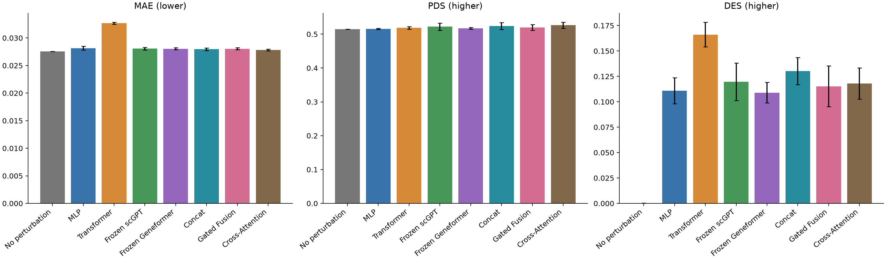

# 三种冻结表示融合的验证比较

## Material Passport

| Field | Value |
| --- | --- |
| Origin Skill | academic-research-suite/experiment-agent |
| Stage | run |
| Date | 2026-10-15 |
| Version | fusion-v1 |
| Verification Status | VERIFIED |

Verification Status 仅指本轮产物与逐 tensor 复现记录，不表示生物学结论或测试集泛化已获验证。

已完成 Concat、Gated Fusion、Cross-Attention 各三个种子，共 9/9 次正式训练和完整官方验证。
主比较纳入原四种模型的均值损失组，共 21 次运行；无扰动对照为固定抽样的一次完整评价。测试集未使用。

## 相同均值损失下的官方成绩

| 方法 | MAE ↓ | PDS ↑ | DES ↑ |
| --- | ---: | ---: | ---: |
| 无扰动对照 | 0.027547 | 0.514400 | 0.000187 |
| MLP | 0.028150 ± 0.000330 | 0.515467 ± 0.001514 | 0.110852 ± 0.012764 |
| Transformer | 0.032676 ± 0.000178 | 0.518667 ± 0.004007 | 0.166169 ± 0.012129 |
| Frozen scGPT | 0.028064 ± 0.000248 | 0.522267 ± 0.010661 | 0.119606 ± 0.018453 |
| Frozen Geneformer | 0.028047 ± 0.000185 | 0.517200 ± 0.002433 | 0.108999 ± 0.010014 |
| Concat | 0.027949 ± 0.000246 | 0.524267 ± 0.009979 | 0.130118 ± 0.013330 |
| Gated Fusion | 0.028035 ± 0.000189 | 0.519867 ± 0.008122 | 0.115208 ± 0.020096 |
| Cross-Attention | 0.027817 ± 0.000182 | 0.526533 ± 0.008821 | 0.117929 ± 0.015328 |

神经模型为种子 42/43/44 的均值 ± 样本标准差。无扰动对照不复制为三个训练种子。
所有模型按相同验证 pseudobulk MAE 选择 checkpoint，采用均值 MSE 损失。本轮未训练融合 MMD/混合损失组。

## 配对差值与条件性结论

下表差值为融合组减参考组；先平均三个种子，再对 50 个相同验证靶点做 5,000 次配对 bootstrap。
MAE 负数更好，PDS/DES 正数更好；括号内是逐靶点重采样的 95% 区间。

| 融合方法 | 参考 | MAE 差值 [95%] | PDS 差值 [95%] | DES 差值 [95%] |
| --- | --- | ---: | ---: | ---: |
| Concat | 无扰动对照 | +0.000403 [+0.000106, +0.000702] | +0.009867 [-0.000933, +0.024270] | +0.129931 [+0.105527, +0.154473] |
| Concat | MLP | -0.000201 [-0.000388, -0.000001] | +0.008800 [-0.001867, +0.021600] | +0.019265 [+0.009131, +0.030643] |
| Concat | Transformer | -0.004726 [-0.005473, -0.003932] | +0.005600 [-0.005333, +0.017733] | -0.036051 [-0.063274, -0.009709] |
| Concat | Frozen scGPT | -0.000115 [-0.000244, +0.000014] | +0.002000 [-0.004000, +0.009067] | +0.010512 [-0.000622, +0.021951] |
| Concat | Frozen Geneformer | -0.000098 [-0.000331, +0.000132] | +0.007067 [-0.002000, +0.019200] | +0.021118 [+0.009525, +0.034067] |
| Gated Fusion | 无扰动对照 | +0.000488 [+0.000233, +0.000747] | +0.005467 [-0.002400, +0.016133] | +0.115021 [+0.089662, +0.140325] |
| Gated Fusion | MLP | -0.000115 [-0.000265, +0.000032] | +0.004400 [-0.002933, +0.014000] | +0.004356 [-0.001066, +0.010269] |
| Gated Fusion | Transformer | -0.004641 [-0.005395, -0.003907] | +0.001200 [-0.007733, +0.010400] | -0.050960 [-0.070205, -0.032444] |
| Gated Fusion | Frozen scGPT | -0.000030 [-0.000125, +0.000063] | -0.002400 [-0.006000, +0.000533] | -0.004397 [-0.007898, -0.000852] |
| Gated Fusion | Frozen Geneformer | -0.000013 [-0.000219, +0.000171] | +0.002667 [-0.003333, +0.010400] | +0.006209 [-0.000027, +0.013087] |
| Cross-Attention | 无扰动对照 | +0.000270 [+0.000024, +0.000516] | +0.012133 [+0.001600, +0.026137] | +0.117742 [+0.096721, +0.138872] |
| Cross-Attention | MLP | -0.000333 [-0.000517, -0.000155] | +0.011067 [+0.000667, +0.023470] | +0.007076 [-0.004880, +0.018983] |
| Cross-Attention | Transformer | -0.004859 [-0.005644, -0.004113] | +0.007867 [-0.002000, +0.019467] | -0.048240 [-0.078640, -0.018338] |
| Cross-Attention | Frozen scGPT | -0.000247 [-0.000399, -0.000101] | +0.004267 [-0.001733, +0.012000] | -0.001677 [-0.016365, +0.012230] |
| Cross-Attention | Frozen Geneformer | -0.000230 [-0.000448, -0.000028] | +0.009333 [+0.000533, +0.020270] | +0.008929 [-0.004215, +0.022064] |

Concat：MAE 均值高于无扰动对照，区间未跨零；PDS 均值高于无扰动对照，区间跨零；DES 均值高于无扰动对照，区间未跨零。

Gated Fusion：MAE 均值高于无扰动对照，区间未跨零；PDS 均值高于无扰动对照，区间跨零；DES 均值高于无扰动对照，区间未跨零。

Cross-Attention：MAE 均值高于无扰动对照，区间未跨零；PDS 均值高于无扰动对照，区间未跨零；DES 均值高于无扰动对照，区间未跨零。

这些区间仅对当前拟合模型、checkpoint 选择、固定对照抽样及验证靶点成立；三个随机种子不是生物重复。
同一验证集用于早停和本轮架构比较，存在选择乐观偏差；区间不含模型选择及重训不确定性，且未做多重比较校正。
三种融合间的全部配对差值同样保存在 paired-comparisons.json。单项改善不能扩大为整体能力提升，也不能据此宣称正式测试集泛化优势。



## 架构、特征与公平性范围

三组共同冻结 scGPT whole-human 与 Geneformer V1-10M，只训练目标/上下文投影、融合头与 64 → 18,080 解码器。
Concat 拼接两个分支；Gated Fusion 为每个扰动学习一个标量门控并加权两个分支。门控权重本身不能证明生物机制。
Cross-Attention 在相同 2,048 个训练 non-targeting 对照细胞上分别运行两个编码器，之后按真实基因 ID 聚合 contextualized gene-token prototypes，再做双向注意力。
Geneformer 保留自身表达秩顺序编码，仅对表达过且非 padding 的 token 按基因 ID 聚合；未把两条池化向量当作 token 序列。
两编码器输入范围仍受固定 256 个训练候选基因及各自词表覆盖限制。跨注意力使用固定训练对照的基因原型，不表示细胞特异或扰动后 token 响应。
所有模型仍输出每个扰动的共同表达位移，细胞异质性来自输入对照细胞，没有额外的细胞状态条件响应。
三种融合头的参数量不同；Cross-Attention 还使用更细的固定 token 信息。共同解码宽度和训练协议不能隔离头容量、信息粒度与融合机制的影响。
因此这轮结果检验当前实现的预测表现；尚不能单独归因于预训练互补或注意力机制，需容量/信息匹配消融再检验。

## 门控权重诊断

| Seed | 验证靶点 scGPT 权重均值 | 范围 | 权重大于0.9的比例 |
| --- | ---: | ---: | ---: |
| 42 | 0.9464 | [0.9079, 0.9735] | 100.0% |
| 43 | 0.6732 | [0.5835, 0.7916] | 0.0% |
| 44 | 0.5753 | [0.4561, 0.6624] | 0.0% |

门控在不同种子间的拟合偏好不同。权重还受投影后分支尺度影响，不能直接当作信息贡献比例，也不能据此认定某一路无用。

## 参数与运行成本

| 方法 | 可训练参数 | 冻结参数 | 总参数 | 训练秒均值 ± SD | 评价秒均值 ± SD | 训练 GPU 峰值 MiB | 共享特征提取秒 |
| --- | ---: | ---: | ---: | ---: | ---: | ---: | ---: |
| MLP | 1,266,144 | 0 | 1,266,144 | 6.26 ± 2.46 | 56.60 ± 3.90 | 367.4 | 0.00 |
| Transformer | 1,279,904 | 0 | 1,279,904 | 5.43 ± 0.09 | 77.98 ± 15.91 | 471.6 | 0.00 |
| Frozen scGPT | 1,292,576 | 50,278,400 | 51,570,976 | 5.39 ± 0.76 | 66.51 ± 8.03 | 368.1 | 6.92 |
| Frozen Geneformer | 1,259,808 | 10,196,992 | 11,456,800 | 6.15 ± 0.62 | 68.36 ± 4.45 | 367.5 | 4.42 |
| Concat | 1,319,584 | 60,475,392 | 61,794,976 | 7.35 ± 0.94 | 70.69 ± 8.47 | 368.7 | 11.34 |
| Gated Fusion | 1,311,457 | 60,475,392 | 61,786,849 | 5.75 ± 1.68 | 80.63 ± 3.15 | 368.6 | 11.34 |
| Cross-Attention | 1,402,400 | 60,475,392 | 61,877,792 | 11.08 ± 1.75 | 61.78 ± 1.51 | 453.0 | 35.96 |

融合组冻结参数指两个来源编码器的参数总和；它们用于离线特征提取，不会同时加载到训练 GPU。共享特征提取耗时是原缓存记录，不按种子重复计费。
Cross-Attention 的共享提取成本包含新增基因 token 原型。GPU 峰值仅为监督训练阶段，不能当作编码器总推理显存；墙钟差异还受缓存及硬件负载影响。
Energy MMD 仅为固定 64+64 细胞抽样的附加指标，逐次值与均值标准差保存在 CSV，不是官方 VCC 主成绩。

## 产物核验与复现

21 次比较均核验发布成绩与原运行一致、50 个逐靶点聚合、18,080 个基因与 98,927 个验证细胞、官方 evaluator 版本、checkpoint SHA256 和原 MLP 控制抽样。
42 个旧 checkpoint 均与各自已发布 SHA256 一致。旧无扰动对照按原核验记录的产物哈希校验，保留其评价时的源码签名。
融合缓存及其源编码器特征的核验见 artifact-verification.json；逐 tensor 复现见 reproducibility-check.json；原始 native token 的身份/观察次数独立重建见 implementation-check.json。Material Passport 仅在三份记录均通过时标记 VERIFIED。
Gated Fusion 的 train/validation 逐靶点权重见 gate_weights.csv，alpha_scgpt 表示 scGPT 分支权重，另一分支权重为 1-alpha。范围与均值诊断只描述当前拟合头，不具有因果或生物机制解释。

```powershell
./.venv/Scripts/python.exe scripts/verify_fusion_artifacts.py
./.venv/Scripts/python.exe -m fusionvc.cli report-fusion
```

[主比较](main_comparison.csv)、[全部逐次成绩与成本](comparison_runs.csv)、[融合运行](runs.csv)、[均值标准差](summary.csv)、
[逐靶点成绩](per_perturbation.csv)、[配对差值区间](paired-comparisons.json)、[来源哈希](report-provenance.json)、
[独立产物核验](artifact-verification.json)、[逐 tensor 复现](reproducibility-check.json)、[门控权重](gate_weights.csv)、[融合协议](../../docs/fusion-protocol.md)。
