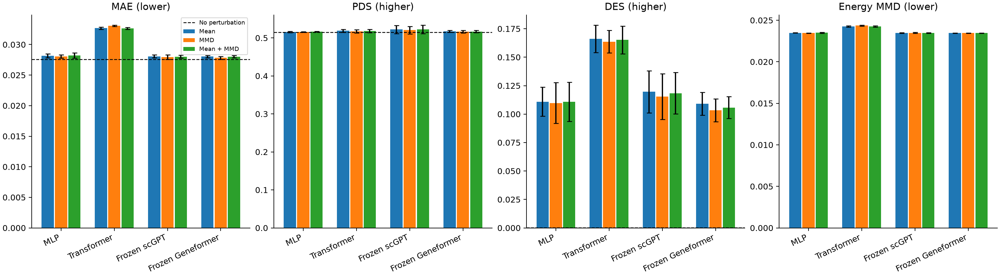

# Frozen Geneformer 验证比较

已完成 Geneformer 三种损失 × 三个种子，共 9/9 次正式训练和完整官方验证。
原 MLP/Transformer/scGPT 的 27 次损失比较保留，总计 36 次。测试集未使用。

## 主比较：相同均值损失

| Model | Seeds | MAE ↓ | PDS ↑ | DES ↑ |
| --- | ---: | ---: | ---: | ---: |
| No perturbation | fixed sample | 0.027547 | 0.514400 | 0.000187 |
| MLP | 3 | 0.028150 ± 0.000330 | 0.515467 ± 0.001514 | 0.110852 ± 0.012764 |
| Transformer | 3 | 0.032676 ± 0.000178 | 0.518667 ± 0.004007 | 0.166169 ± 0.012129 |
| Frozen scGPT | 3 | 0.028064 ± 0.000248 | 0.522267 ± 0.010661 | 0.119606 ± 0.018453 |
| Frozen Geneformer | 3 | 0.028047 ± 0.000185 | 0.517200 ± 0.002433 | 0.108999 ± 0.010014 |

无扰动辅助对照 MAE = **0.027547**。无扰动对照 DES = **0.000187**，已使用相同完整细胞、DE 和 FDR 流程补算。
Geneformer 主组 MAE 相比 MLP 降低 0.37%；50 靶点配对差值 95% 区间 [-0.000194, -0.000010]。
Geneformer 主组 MAE 相比 Transformer 降低 14.16%；50 靶点配对差值 95% 区间 [-0.005318, -0.003947]。
Geneformer 主组 MAE 相比 Frozen scGPT 降低 0.06%；50 靶点配对差值 95% 区间 [-0.000227, 0.000206]。
主组 MAE 高于无扰动对照。区间先平均种子，再重采样验证靶点，仅对当前拟合模型成立。
PDS/DES 需同时比较，单项改善不代表整体能力提升。

## 损失对照

| Model | Loss | Seeds | MAE ↓ | PDS ↑ | DES ↑ | Energy MMD ↓ |
| --- | --- | ---: | ---: | ---: | ---: | ---: |
| MLP | Mean | 3 | 0.028150 ± 0.000330 | 0.515467 ± 0.001514 | 0.110852 ± 0.012764 | 0.023479 ± 0.000023 |
| MLP | MMD | 3 | 0.028053 ± 0.000272 | 0.515600 ± 0.001058 | 0.109802 ± 0.017928 | 0.023468 ± 0.000022 |
| MLP | Mean + MMD | 3 | 0.028229 ± 0.000433 | 0.516133 ± 0.000833 | 0.110811 ± 0.017304 | 0.023498 ± 0.000049 |
| Transformer | Mean | 3 | 0.032676 ± 0.000178 | 0.518667 ± 0.004007 | 0.166169 ± 0.012129 | 0.024269 ± 0.000080 |
| Transformer | MMD | 3 | 0.033085 ± 0.000113 | 0.517200 ± 0.004543 | 0.163695 ± 0.010009 | 0.024365 ± 0.000065 |
| Transformer | Mean + MMD | 3 | 0.032637 ± 0.000170 | 0.518133 ± 0.004406 | 0.165171 ± 0.012157 | 0.024262 ± 0.000080 |
| Frozen scGPT | Mean | 3 | 0.028064 ± 0.000248 | 0.522267 ± 0.010661 | 0.119606 ± 0.018453 | 0.023479 ± 0.000044 |
| Frozen scGPT | MMD | 3 | 0.027938 ± 0.000378 | 0.520667 ± 0.009833 | 0.115443 ± 0.020039 | 0.023490 ± 0.000065 |
| Frozen scGPT | Mean + MMD | 3 | 0.028013 ± 0.000235 | 0.522800 ± 0.011200 | 0.118345 ± 0.018285 | 0.023475 ± 0.000041 |
| Frozen Geneformer | Mean | 3 | 0.028047 ± 0.000185 | 0.517200 ± 0.002433 | 0.108999 ± 0.010014 | 0.023453 ± 0.000019 |
| Frozen Geneformer | MMD | 3 | 0.027828 ± 0.000232 | 0.516533 ± 0.003107 | 0.103298 ± 0.010003 | 0.023461 ± 0.000016 |
| Frozen Geneformer | Mean + MMD | 3 | 0.028013 ± 0.000192 | 0.516667 ± 0.002948 | 0.105782 ± 0.009513 | 0.023458 ± 0.000010 |

表中为三个种子的均值 ± 标准差；控制抽样固定。Energy MMD 是固定 64+64 细胞的附加抽样指标。
所有组按验证 pseudobulk MAE 选择 checkpoint，混合系数 0.1 预先固定。
Geneformer MMD 相比其均值组 MAE 降低 0.78%；PDS 降低, DES 降低, Energy MMD 升高。
Geneformer Mean + MMD 相比其均值组 MAE 降低 0.12%；PDS 降低, DES 降低, Energy MMD 升高。
Geneformer 三组 MAE 均未超过无扰动对照，本轮没有显示对平均表达误差的稳定优势。

## 实现、来源与成本

使用固定 V1-10M，冻结 10,196,992 个参数，101 个编码器张量严格加载。
真实 BERT 编码器对照最大绝对差异 0；官方排序和非 pad pooling 检查通过。
提取 2,048 个训练对照细胞耗时 4.42 秒，GPU 峰值 146.7 MiB，九次训练共享。
候选输入覆盖 254/256；缺失输入 C13orf42, APELA。
输出保留 18,080 个基因，预训练词表覆盖 17,915 个；
训练靶点覆盖 150/150，验证靶点覆盖 50/50。
按原始 var/gene_id 映射，非零 token 长度 128–254，均值 211.83。
输入只由训练对照和预训练资源构建。最后一层非 pad 均值作为 context，靶点使用冻结 word embedding、训练描述与覆盖标记。
投影及统一 64 → 18,080 解码器可训练；编码器完全冻结。输出保持共同条件位移。
输入覆盖、秩编码、预训练语料和预测头维度存在差异，不能完全隔离纯预训练效果。受限输入不能等同于完整转录组标准零样本 Geneformer。

[逐次成本](runs.csv)、[全部比较](comparison_runs.csv)、[逐靶点结果](per_perturbation.csv)、
[配对差值区间](paired-comparisons.json)、[实现检查](implementation-parity.json)、
[逐 tensor 复现](reproducibility-check.json)、[产物核验](artifact-verification.json)、
[特征来源](features.json)、[实验协议](../../docs/geneformer-protocol.md)。
[无扰动与四模型的完整三指标比较](../controls/README.md)。
