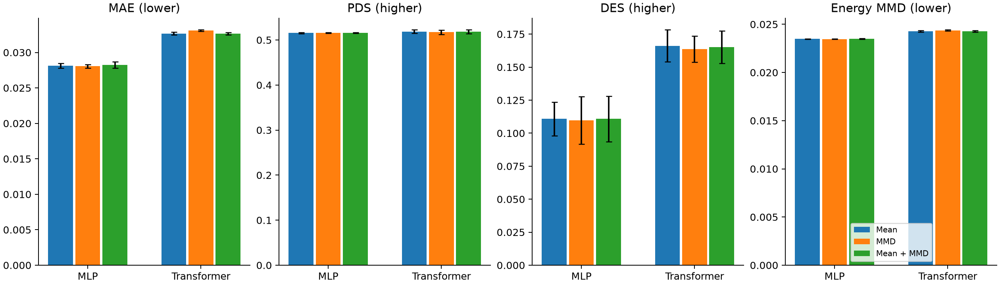

# MMD 对照实验结果

已完成 18/18 次正式验证：MLP 和 Transformer 各三种训练方式，每种三个随机种子。
模型结构、数据、基因数量、训练预算上限和模型选择规则相同，只改变训练时怎样判断预测好坏。
原始对照比较一群细胞的平均值；MMD 比较两群细胞的分布；混合组同时比较两者。
输出覆盖全部 18,080 个基因，使用官方验证划分；这些是验证成绩，测试集未使用。

| Model | Loss | Seeds | MAE ↓ | PDS ↑ | DES ↑ | Energy MMD ↓ |
| --- | --- | ---: | ---: | ---: | ---: | ---: |
| mlp | MMD | 3 | 0.028053 ± 0.000272 | 0.515600 ± 0.001058 | 0.109802 ± 0.017928 | 0.023468 ± 0.000022 |
| mlp | Mean + MMD | 3 | 0.028229 ± 0.000433 | 0.516133 ± 0.000833 | 0.110811 ± 0.017304 | 0.023498 ± 0.000049 |
| mlp | Mean | 3 | 0.028150 ± 0.000330 | 0.515467 ± 0.001514 | 0.110852 ± 0.012764 | 0.023479 ± 0.000023 |
| transformer | MMD | 3 | 0.033085 ± 0.000113 | 0.517200 ± 0.004543 | 0.163695 ± 0.010009 | 0.024365 ± 0.000065 |
| transformer | Mean + MMD | 3 | 0.032637 ± 0.000170 | 0.518133 ± 0.004406 | 0.165171 ± 0.012157 | 0.024262 ± 0.000080 |
| transformer | Mean | 3 | 0.032676 ± 0.000178 | 0.518667 ± 0.004007 | 0.166169 ± 0.012129 | 0.024269 ± 0.000080 |

表中为三个种子的均值 ± 标准差。MAE 是表达平均误差，越低越好；
PDS 衡量能否区分不同扰动，DES 衡量关键变化基因的预测重合程度，越高越好。
Energy MMD 是额外的细胞群差异检查，越低越好；不是官方综合得分。

本次 MLP 的纯 MMD 组 MAE 相比原对照降低 0.35%；
Transformer 的混合组降低 0.12%。
这两种 MAE 改善幅度很小，DES 都未同步提高；Transformer 的纯 MMD 组四项平均指标均变差。
各新训练组的 MAE 仍高于已有无扰动对照 0.027547。
本轮没有观察到整体预测能力的明显提升，因此保留原模型作为后续实验的正式基线。
这说明当前条件下仅改变损失收益有限，不能据此断言 MMD 在其他模型或数据上无效。

附加 Energy MMD 每个验证靶点固定独立抽取 64 个预测细胞和 64 个真实细胞，有抽样误差。
混合权重预先固定为 0.1；energy kernel 除以基因数平方根，属于固定尺度变换。
所有组仍按验证集平均误差挑选模型，这可能限制针对分布的改善。
当前模型对同一扰动学习共同的表达位移，尚未学习各细胞状态对应的独立响应，也未实现 State 的细胞集合 attention。

原均值对照全部重新训练，与旧 checkpoint 权重完全一致，见 [baseline-parity.json](baseline-parity.json)。
六次均值对照的官方评分与旧结果完全一致，见 [evaluation-reference-parity.json](evaluation-reference-parity.json)。
按靶点的差值区间见 [paired-comparisons.json](paired-comparisons.json)：先平均种子，再对 50 个验证靶点重采样；不代表测试集表现保证。
完整方案见 [mmd-protocol.md](../../docs/mmd-protocol.md)，每次运行见 [runs.csv](runs.csv)。
