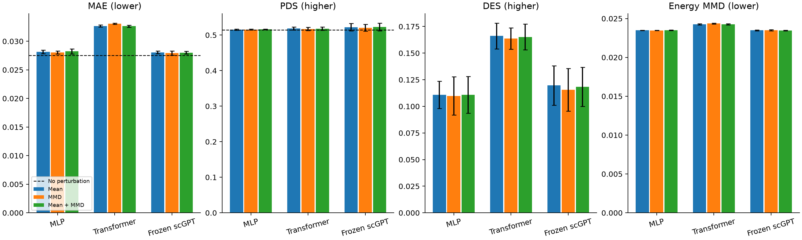

# Frozen scGPT 验证比较

已完成 scGPT 三种损失 × 三个种子，共 9/9 次正式训练和完整官方验证。
原 MLP/Transformer 共 18 次损失对照作为固定参考，结果保留。测试集未使用。

## 主比较：相同均值损失

| Model | Seeds | MAE ↓ | PDS ↑ | DES ↑ |
| --- | ---: | ---: | ---: | ---: |
| No perturbation | fixed sample | 0.027547 | 0.514400 | 0.000187 |
| MLP | 3 | 0.028150 ± 0.000330 | 0.515467 ± 0.001514 | 0.110852 ± 0.012764 |
| Transformer | 3 | 0.032676 ± 0.000178 | 0.518667 ± 0.004007 | 0.166169 ± 0.012129 |
| Frozen scGPT | 3 | 0.028064 ± 0.000248 | 0.522267 ± 0.010661 | 0.119606 ± 0.018453 |

无扰动对照 MAE = **0.027547**。无扰动对照 DES = **0.000187**，已使用相同完整细胞、DE 和 FDR 流程补算。
Frozen scGPT 主组 MAE 相比 MLP 降低 0.30%。
Frozen scGPT 主组 MAE 相比 Transformer 降低 14.11%。
其 MAE 高于无扰动对照；PDS/DES 请同时查看，单项改善不代表整体能力提升。
相对 MLP，主组 MAE 的 50 靶点配对 bootstrap 95% 差值区间包含 0，改善未显示稳定优势；
DES 的配对差值区间高于 0，但其 DES 仍低于随机 Transformer。区间仅对本轮拟合模型与验证靶点成立。

## 损失对照

| Model | Loss | Seeds | MAE ↓ | PDS ↑ | DES ↑ | Energy MMD ↓ |
| --- | --- | ---: | ---: | ---: | ---: | ---: |
| MLP | Mean | 3 | 0.028150 ± 0.000330 | 0.515467 ± 0.001514 | 0.110852 ± 0.012764 | 0.023479 ± 0.000023 |
| MLP | MMD | 3 | 0.028053 ± 0.000272 | 0.515600 ± 0.001058 | 0.109802 ± 0.017928 | 0.023468 ± 0.000022 |
| MLP | Mean + MMD | 3 | 0.028229 ± 0.000433 | 0.516133 ± 0.000833 | 0.110811 ± 0.017304 | 0.023498 ± 0.000049 |
| Transformer | Mean | 3 | 0.032676 ± 0.000178 | 0.518667 ± 0.004007 | 0.166169 ± 0.012129 | 0.024269 ± 0.000080 |
| Transformer | MMD | 3 | 0.033085 ± 0.000113 | 0.517200 ± 0.004543 | 0.163695 ± 0.010009 | 0.024365 ± 0.000065 |
| Transformer | Mean + MMD | 3 | 0.032637 ± 0.000170 | 0.518133 ± 0.004406 | 0.165171 ± 0.012157 | 0.024262 ± 0.000080 |
| Frozen scGPT | Mean | 3 | 0.028064 ± 0.000248 | 0.522267 ± 0.010661 | 0.119606 ± 0.018453 | 0.023479 ± 0.000044 |
| Frozen scGPT | MMD | 3 | 0.027938 ± 0.000378 | 0.520667 ± 0.009833 | 0.115443 ± 0.020039 | 0.023490 ± 0.000065 |
| Frozen scGPT | Mean + MMD | 3 | 0.028013 ± 0.000235 | 0.522800 ± 0.011200 | 0.118345 ± 0.018285 | 0.023475 ± 0.000041 |

表中为三个种子的均值 ± 标准差；控制抽样固定。Energy MMD 是固定 64+64 细胞的附加抽样指标。
所有组继续按验证 pseudobulk MAE 挑选 checkpoint，混合系数 0.1 预先固定。
scGPT 纯 MMD 相对其均值组的 MAE 降低 0.45%，DES 和 PDS 均下降，附加 Energy MMD 也没有同步改善。
混合组 MAE 同样小幅下降、DES 略降；三组仍未超过无扰动 MAE 对照，本轮没有观察到整体能力的明显提升。

## 实现与成本

使用已下载 whole-human 权重，冻结参数 50,278,400；153 个编码器张量严格加载。
完整编码器相对官方固定版本的最大绝对差异 6.5565109e-06，表达分箱在相同随机数下完全一致；未静默随机初始化缺失层。
一次提取 2,048 个训练对照细胞，耗时 6.92 秒，GPU 峰值 264.1 MiB；该缓存被九次训练共享。
固定 256 输入基因中 242 个被词表识别；全部 18,080 个输出保留，词表覆盖 17,840 个。
全部 150 个训练靶点和 50 个验证靶点均被词表覆盖；缺失靶点回退策略已实现，本轮没有触发。
对照特征只来自训练 non-targeting 细胞；靶点使用冻结基因 embedding、训练对照描述与覆盖标记。
监督阶段训练投影和统一 64 → 18,080 解码器；平均对照表示保持共同条件位移模型，没有新增状态依赖响应。
这是冻结 scGPT 特征迁移比较；输入可识别基因数和预测头略有差异，不能完全隔离纯预训练效应。

[每次训练与评价成本](runs.csv)、[全部比较运行](comparison_runs.csv)、[按靶点结果](per_perturbation.csv)、
[配对差值与区间](paired-comparisons.json)、[实现一致性](implementation-parity.json)、
[逐 tensor 复现](reproducibility-check.json)、[完整产物校验](artifact-verification.json)、
[特征来源及覆盖率](features.json)、[实验协议](../../docs/scgpt-protocol.md)。
[无扰动与四模型的完整三指标比较](../controls/README.md)。
